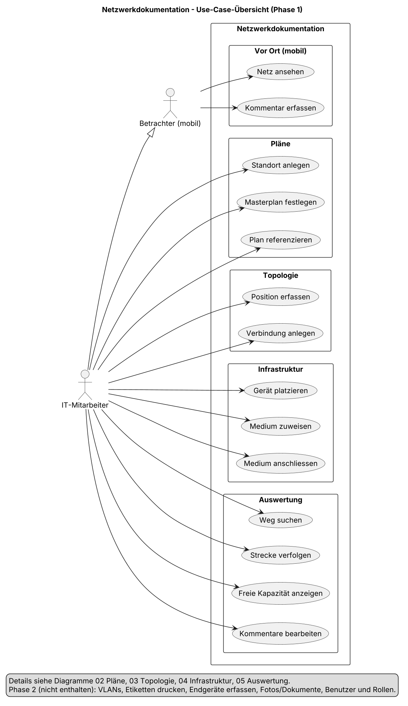
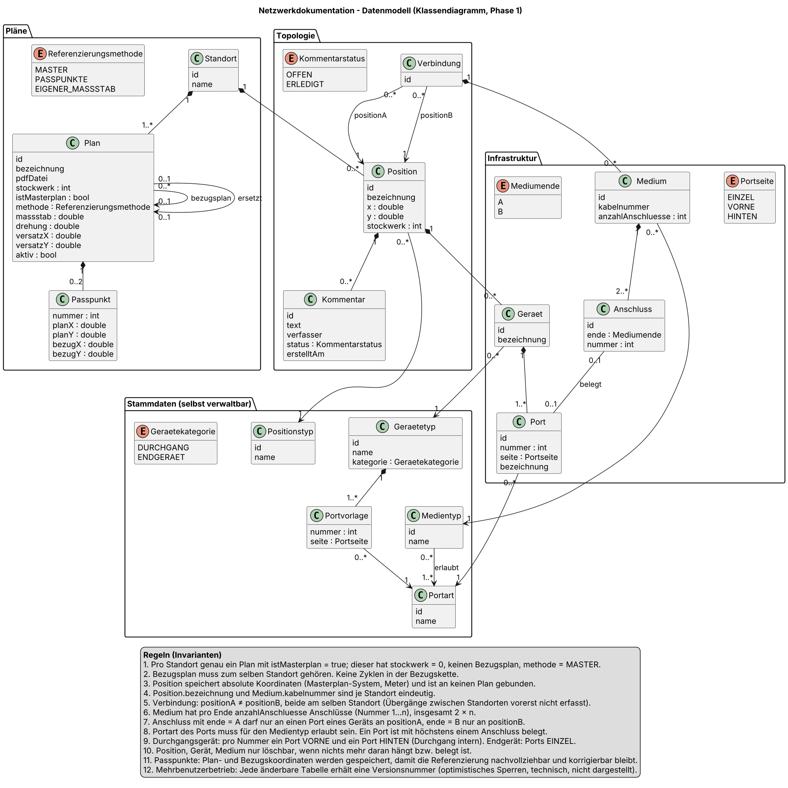
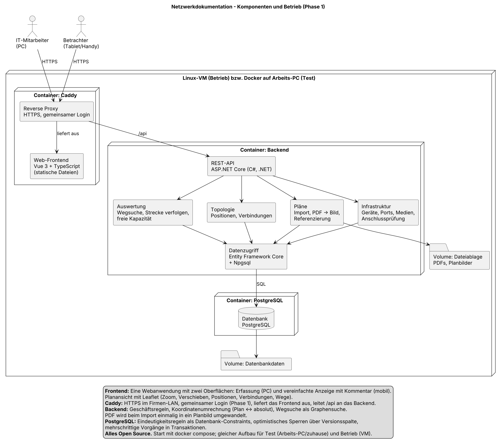

# Netzwerkdokumentation – Konzept Phase 1

Stand: 18.10.2026 · Claudia

> Arbeitsversion des Konzepts: https://claude.ai/code/artifact/6de775c8-c87e-4f9c-bb0d-cc7bc31aaf80
> Diese Datei ist die Kopie im Repository. Diagramm-Quellen (PlantUML) und PDFs liegen in [`diagramme/`](diagramme/).

## Ausgangslage und Ziel

Die Netzwerkdokumentation der IT-Abteilung wird von Visio auf eine eigene, datenbankbasierte Webanwendung umgestellt. Die bisherige Dokumentation ist aufwändig zu erstellen und unübersichtlich, weil jede Leitung von Hand gezeichnet werden muss.

Die neue Lösung bildet das Netz anhand von Plänen ab: Pro Standort gibt es einen Masterplan mit absolutem Nullpunkt, alle weiteren Pläne werden darauf referenziert. Positionen (Rack, Bodendose, Richtfunksender …) werden per Klick erfasst, Verbindungen zwischen Positionen nur als «existiert» festgehalten – der genaue Leitungsverlauf und die Ausführungsart (Kanal, Rohr, Trasse) sind für die IT nicht relevant.

Die Software soll drei Fragen beantworten:

1. Welcher Weg führt von einer Position zu einer anderen?
2. Ist auf diesem Weg noch ein freies Medium und ein freier Port verfügbar?
3. Wo stehen die Geräte und wie sind sie miteinander verbunden?

**Umfang Phase 1:** 3 Standorte (von 4 im Unternehmen), Erfassung durch die IT-Abteilung, Anzeige und Kommentare vor Ort auf Tablet und Handy. Ausbaumöglichkeiten sind im letzten Abschnitt gesammelt.

## Begriffe

Diese Begriffe gelten verbindlich in Konzept, Datenbank und Code.

| Begriff | Bedeutung |
| --- | --- |
| Standort | Firmenstandort (Areal). Hat genau einen Masterplan. |
| Plan | Einseitiges PDF (Gelände, Gebäude, Geschoss, Raum) mit eigenem Massstab und Stockwerk. |
| Masterplan | Bezugsplan eines Standorts mit absolutem Nullpunkt (0,0,0), Stockwerk fix 0, immer im Übersichtsmodus. |
| Referenzieren | Einen Plan auf den Masterplan oder einen bereits referenzierten Plan ausrichten: Verschiebung, Drehung, Massstab. |
| Passpunkt | Punkt, der auf neuem Plan und Bezugsplan identifizierbar ist. Zwei Passpunkte ergeben die Referenzierung. |
| Stockwerk | Ganze Zahl: 0 = EG, 1 = 1.OG, -1 = 1.UG. |
| Übersichtsmodus | Anzeige über alle Stockwerke hinweg. Verbindungen werden nur hier angelegt. |
| Position | Punkt im Netz (Rack, Bodendose, Richtfunksender …) mit Bezeichnung, absoluter Koordinate und Stockwerk. |
| Positionstyp | Selbst verwaltbare Art einer Position. |
| Verbindung | Tatsache, dass zwischen zwei Positionen ein Weg für Medien existiert. Ohne Verlauf und Ausführungsart. |
| Gerät | Objekt an einer Position mit mindestens einem Port, erzeugt aus einem Gerätetyp. |
| Durchgangsgerät | Gerät, das ein Medium durchreicht (Patchpanel, Netzwerkdose). Pro Portnummer ein Port VORNE und einer HINTEN. |
| Endgerät | Gerät, an dem eine Strecke endet (Switch, Access Point, PC, Steuerung, Drucker). |
| Port | Anschlussstelle eines Geräts mit Portart (RJ45, LC, SC, SFP …), automatischer Nummer und freier Bezeichnung. |
| Medium | Kabel oder Funkstrecke auf einer Verbindung (LWL Singlemode, LWL Multimode, Cu, Richtfunk) mit Kabelnummer. |
| Anschluss | Ein Ende einer Ader/Faser eines Mediums. Ein Medium mit n Fasern hat 2 × n Anschlüsse. |
| Patchung | Patchkabel zwischen zwei Ports derselben Position (z.B. Patchpanel vorne → Switch). |

## Use Cases

Phase 1 umfasst fünf Bereiche und zwei Akteure. Der **IT-Mitarbeiter** erfasst und wertet aus, der **Betrachter (mobil)** sieht nur an und kommentiert. Der IT-Mitarbeiter kann alles, was der Betrachter kann.

### Pläne

| Use Case | Festlegung |
| --- | --- |
| Standort anlegen | Voraussetzung für den Masterplan. |
| Masterplan festlegen | Genau einer pro Standort. Nullpunkt (0,0,0) an markantem Punkt, Massstab über zwei bekannte Strecken in x- und y-Richtung, Stockwerk fix 0. |
| Plan importieren | Nur einseitige PDFs. |
| Plan referenzieren | Bezug ist der Masterplan oder ein bereits referenzierter Plan (Kette, z.B. Raum → Geschoss → Campus). Jeder Plan hat seinen eigenen Massstab. Stockwerk ist Pflicht, Vorgabe 0. |
| Über Passpunkte referenzieren | Standardfall: Plan ist auf dem Bezugsplan erkennbar. Zwei Passpunkte ergeben Verschiebung, Drehung und Massstab. Passpunkte werden gespeichert. |
| Mit eigenem Massstab referenzieren | Fallback, wenn der Plan auf keinem Bezugsplan erkennbar ist: Massstab über bekannte Strecken im Plan, Lage per Klick oder Koordinate in Metern, Drehung als Winkel oder Richtung. |
| Referenz prüfen | Optional: Nachmessen einer bekannten Strecke. |
| Plan ersetzen | Neue Planversion nach Umbau. Positionen bleiben erhalten, nur der neue Plan wird referenziert. |

### Topologie

| Use Case | Festlegung |
| --- | --- |
| Positionstypen verwalten | Typen selbst anlegbar. |
| Position erfassen | Klick in einen Plan. Bezeichnung vom Benutzer (z.B. «Serverraum 1», «HV4»), eindeutig pro Standort. Gespeichert werden ID, absolute Koordinate und Stockwerk. |
| Position bearbeiten / löschen | Löschen gesperrt, solange Verbindungen oder Geräte daran hängen. |
| Plan mit Positionen anzeigen | Eine Position erscheint auf jedem Plan, dessen Bereich ihre Koordinate abdeckt und dessen Stockwerk passt. |
| Stockwerke zusammenfassen | Übersichtsmodus, auf jedem Plan schaltbar, z.B. für den Weg vom Serverraum im 3. OG zum Verteiler im UG. |
| Verbindung anlegen / löschen | Nur im Übersichtsmodus, zwei Positionen anwählen. Beide am selben Standort. |

### Infrastruktur

| Use Case | Festlegung |
| --- | --- |
| Portarten verwalten | Selbst anlegbar (RJ45, LC, SC, SFP …). |
| Medientypen verwalten | Selbst anlegbar. Singlemode und Multimode sind getrennte Medientypen. Jeder Medientyp hat eine Liste erlaubter Portarten. |
| Gerätetypen verwalten | Vorlage mit Kategorie (Durchgang oder Endgerät) und Ports mit Portart, z.B. «Patchpanel 24× RJ45». |
| Gerät platzieren / entfernen | An einer Position; Ports werden aus der Vorlage erzeugt. Lage im Rack (Höheneinheit) vorerst nicht erfasst. |
| Medium zuweisen / entfernen | Zu einer Verbindung, mit Medientyp, Kabelnummer (eindeutig pro Standort) und Anzahl Anschlüsse pro Ende. |
| Medium anschliessen / Anschluss lösen | Je Anschluss ein Port an der jeweiligen End-Position. Geprüft wird: Port frei, Portart für den Medientyp erlaubt. |
| Patchen / Patchung entfernen | Zwei freie Ports derselben Position verbinden, mit optionaler Beschriftung. Ein Port ist entweder an ein Medium angeschlossen oder gepatcht. |

### Auswertung und vor Ort

| Use Case | Festlegung |
| --- | --- |
| Weg suchen | Von Position zu Position oder von Gerät/Port zu Gerät/Port. Filter «nur Wege mit freier Kapazität». Ergebnis wird im Plan markiert. |
| Leitungsverlauf | Von einem Port aus durch Kabel, Patchpanels (vorne ↔ hinten) und Patchungen bis zu den Endgeräten bzw. offenen Enden. Aktive Geräte (Switches) werden nicht durchquert. |
| Strecke verfolgen | Von einem Port über Durchgangsgeräte bis zum nächsten Endgerät. |
| Freie Kapazität anzeigen | Pro Position oder Gerät sowie zwischen Positionen (z.B. alle freien LWL-Fasern zwischen Gebäude A und B). |
| Kommentar erfassen (mobil) | Hängt an einer Position, mit Verfasser (freies Feld), Status «offen». |
| Kommentare bearbeiten | Im Büro auswerten, Korrekturen vornehmen, Status auf «erledigt». |
| Netz ansehen (mobil) | Nur Anzeige, vereinfachte Oberfläche. |

Diagramme: `diagramme/uc_01` bis `uc_05` (PlantUML und PDF).

## Datenmodell

Positionen hängen am Standort, nicht am Plan: Sie speichern nur ihre absolute Koordinate, Pläne sind reine Ansichten darauf. So erscheint eine Position automatisch auf allen passenden Plänen, und beim Ersetzen eines Plans geht nichts verloren.

| Klasse | Wichtige Attribute | Beziehungen |
| --- | --- | --- |
| Standort | name | hat Pläne und Positionen |
| Plan | bezeichnung, pdfDatei, stockwerk, istMasterplan, methode, massstab, drehung, versatzX/Y, aktiv | gehört zu Standort; bezugsplan, ersetzt (je ein Plan); hat bis zu 2 Passpunkte |
| Passpunkt | nummer, planX/Y, bezugX/Y | gehört zu Plan |
| Position | bezeichnung, x, y, stockwerk | gehört zu Standort; hat Positionstyp, Geräte, Kommentare |
| Verbindung | – | positionA, positionB; hat Medien |
| Kommentar | text, verfasser, status (offen/erledigt), erstelltAm | gehört zu Position |
| Gerät | bezeichnung | an Position; hat Gerätetyp, Ports |
| Port | nummer, seite (EINZEL/VORNE/HINTEN), bezeichnung | gehört zu Gerät; hat Portart |
| Medium | kabelnummer, anzahlAnschluesse | gehört zu Verbindung; hat Medientyp, Anschlüsse |
| Anschluss | ende (A/B), nummer | gehört zu Medium; belegt höchstens einen Port |
| Patchung | bezeichnung | an Position; verbindet genau zwei Ports |
| Gerätetyp | name, kategorie (Durchgang/Endgerät) | hat Portvorlagen |
| Portvorlage | nummer, seite | gehört zu Gerätetyp; hat Portart |
| Positionstyp, Portart | name | Stammdaten |
| Medientyp | name | erlaubt eine oder mehrere Portarten |

### Regeln

1. Pro Standort genau ein Masterplan; dieser hat Stockwerk 0, keinen Bezugsplan, Methode MASTER.
2. Der Bezugsplan gehört zum selben Standort. Keine Zyklen in der Bezugskette.
3. Positionen speichern absolute Koordinaten in Metern im System des Masterplans.
4. Positionsbezeichnung und Kabelnummer sind je Standort eindeutig.
5. Eine Verbindung verbindet zwei verschiedene Positionen am selben Standort. Übergänge zwischen Standorten werden vorerst nicht erfasst.
6. Ein Medium hat pro Ende n Anschlüsse (Nummer 1 bis n), insgesamt 2 × n.
7. Ende A wird nur an einen Port an positionA angeschlossen, Ende B nur an positionB. Beim Anlegen einer Verbindung wird die zuerst angeklickte Position zu positionA.
8. Die Portart muss für den Medientyp erlaubt sein. Ein Port ist mit höchstens einem Anschluss belegt.
9. Durchgangsgerät: pro Nummer ein Port VORNE und einer HINTEN, intern durchverbunden. Endgerät: Ports EINZEL.
10. Position, Gerät und Medium sind nur löschbar, wenn nichts mehr daran hängt bzw. belegt ist.
11. Eine Patchung verbindet zwei verschiedene Ports derselben Position. Ein Port ist höchstens einmal belegt – entweder durch einen Anschluss oder durch eine Patchung.
12. Eine Faser/Ader ist **frei**, wenn jedes ihrer beiden Enden entweder noch nicht aufgelegt ist oder auf einem Durchgangsgerät aufliegt, dessen Gegenseite (z.B. Patchpanel vorne) frei ist. Die freie Kapazität eines Weges ist die kleinste Zahl freier Fasern über alle Abschnitte.

Quelle: `diagramme/kd_01_datenmodell.puml`.

## Mehrbenutzerbetrieb

Gleichzeitige Änderungen werden mit drei Mechanismen abgesichert. Andere Clients werden nicht automatisch über Änderungen informiert.

| Fall | Beispiel | Lösung |
| --- | --- | --- |
| Zwei Personen ändern denselben Datensatz | Eine benennt «HV4» um, die andere verschiebt die Position | Optimistisches Sperren: Jede änderbare Tabelle hat eine Versionsnummer. Ist sie beim Speichern nicht mehr dieselbe wie beim Laden, wird abgelehnt: «Wurde inzwischen geändert, bitte neu laden.» |
| Zwei Personen belegen dieselbe Ressource | Beide schliessen eine Faser am selben freien Port an | Eindeutigkeitsregel in der Datenbank: Ein Port kommt in der Anschlusstabelle nur einmal vor. Ebenso Positionsbezeichnung und Kabelnummer je Standort. |
| Vorgang mit vielen Schritten | Gerät mit 48 Ports platzieren, 12-Faser-Kabel komplett anschliessen | Transaktion: Entweder gelingt alles oder nichts. |

Die Regeln sitzen in der Datenbank selbst und gelten damit auch für spätere Importe oder weitere Clients.

## Architektur und Komponenten

Die Anwendung ist eine Webanwendung im Firmen-LAN aus drei Docker-Containern, vollständig Open Source. Getestet wird mit Docker auf dem Arbeits-PC oder zu Hause, betrieben auf einer Linux-VM mit demselben docker-compose-Aufbau.

Der Browser spricht nur mit Caddy; Caddy leitet /api an das Backend weiter, nur das Backend greift auf die Datenbank und die Dateiablage zu.

| Komponente | Technik | Aufgabe |
| --- | --- | --- |
| Reverse Proxy | Caddy | HTTPS im LAN, gemeinsamer Login für Phase 1, liefert das Frontend aus |
| Frontend | Vue 3, TypeScript, Leaflet | Erfassungsoberfläche (PC) und vereinfachte Anzeige mit Kommentar (mobil); Planansicht mit Zoom, Positionen, Verbindungen, Wegen |
| Backend | ASP.NET Core (C#, .NET, MIT-Lizenz) | REST-API, Geschäftsregeln, Koordinatenumrechnung Plan ↔ absolut, Wegsuche als Graphensuche, PDF → Planbild beim Import |
| Datenzugriff | Entity Framework Core, Npgsql | Abbildung des Datenmodells, Versionsprüfung, Transaktionen |
| Datenbank | PostgreSQL | Daten, Eindeutigkeitsregeln als Constraints |
| Ablage | Docker-Volumes | PDFs und Planbilder; Datenbankdateien |

Zugang: In Phase 1 ein gemeinsamer Login am Reverse Proxy. Deshalb hat der Kommentar ein freies Feld «verfasser».

## Phase 2 und nächste Schritte

Phase 2 ist bewusst ausgeklammert; das Modell lässt die folgenden Erweiterungen offen:

- VLANs anzeigen, z.B. über das Ubiquiti-Portal oder den Import von Switchkonfigurationen
- Beschriftungen für Patchpanels drucken
- Endgeräte erfassen
- Fotos und Dokumentationen hinterlegen
- Lage im Rack (Höheneinheit)
- Benutzer und Rollen, z.B. Anbindung an Active Directory oder LDAP
- Übergänge zwischen Standorten

Nächste Schritte der Umsetzung:

- [ ] Projektgerüst: Ordnerstruktur, docker-compose.yml, leeres Backend und Frontend, Anleitung für Docker Desktop unter Windows
- [ ] Datenbankschema: Entity-Framework-Klassen und erste Migration inklusive Constraints
- [ ] Erstes sichtbares Ergebnis: Standort anlegen, Masterplan importieren und im Browser anzeigen
- [ ] Linux-VM für den Betrieb erstellen
